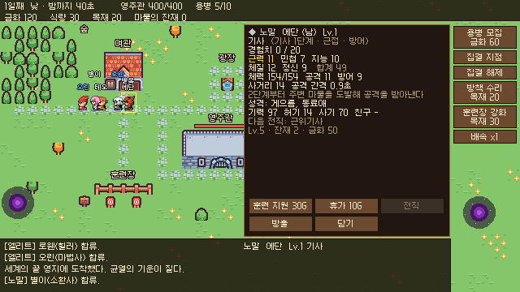
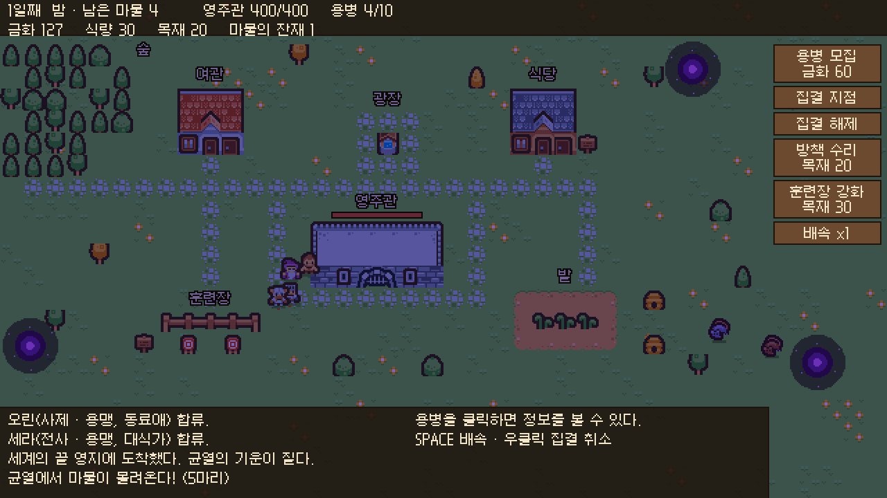

# 아그라 전기 (Agra Chronicles)

마을 운영 + 자유 의지 AI 용병 + 균열 디펜스. Godot 4 · 탑다운 2D 픽셀.

세계의 끝 영지의 영주가 되어 마을을 꾸리고 용병을 모아, 밤마다 균열에서 쏟아지는 마물을 막아낸다.
용병들은 직접 조종하는 유닛이 아니다. 각자 성격과 욕구에 따라 살고 싸운다.

| 낮 | 밤 |
|---|---|
|  |  |

## 실행

1. [Godot 4.7+](https://godotengine.org/download)를 설치한다 (Standard 버전이면 된다).
2. Godot에서 이 폴더의 `project.godot`을 연다.
3. F5를 눌러 실행한다.

## 조작 (프로토타입)

| 입력 | 동작 |
|---|---|
| 좌클릭 (쪼꼬미) | 육성 창: 훈련 지원 · 휴가 · 전직 · 방출 |
| 오른쪽 메뉴 | 용병 모집 · 집결 지점 · 집결 해제 · 방책 수리 · 훈련장 강화 · 배속 |
| 우클릭 | 집결 지점 지정 취소 |
| SPACE | 배속 전환 |
| R | 패배 후 다시 시작 |

## 헤드리스 스모크 테스트

며칠을 10배속으로 자동 진행하며 오류와 기본 흐름(밤 침공, 날짜 진행)을 확인한다.

```
godot --headless --path . --fixed-fps 60 --script res://tests/smoke_test.gd
```

`RESULT PASS`와 종료 코드 0이면 정상이다.

육성 시스템(등급 분포, 레벨업, 전직, 방출, 소환수) 테스트:

```
godot --headless --path . --script res://tests/growth_test.gd
```

`RESULT PASS (0 failures)`이면 정상이다.

## 구조

```
project.godot
scenes/main.tscn       메인 씬 (노드는 스크립트에서 생성)
scripts/main.gd        자원 · 낮/밤 · 웨이브 · HUD · 맵 그리기
scripts/mercenary.gd   쪼꼬미 (탄생 · 성장 · 전직, 유틸리티 AI 생활, 직업별 전투)
scripts/monster.gd     균열 마물
scripts/job_data.gd    직업 · 등급 · 능력치 표 (새 직업은 여기에 추가)
scripts/summon.gd      소환사의 소환수
scripts/map_art.gd     그림 불러오기 · 맵 타일 배정
scripts/char_sprites.gd 쪼꼬미 외형 (성별·직업별 캐릭터 배정)
tests/                 growth_test · smoke_test · screenshot
tools/make_codemap.py  graphify 그래프 → CODEMAP.md
graphify-out/          코드 지도 (CODEMAP.md, GRAPH_REPORT.md, graph.html)
docs/기획서_v0.5.md     게임 기획서
docs/인수인계.md        진척 현황 · 검증 · 라이선스 · 다음 작업
```

화면 캡처: `godot --path . --script res://tests/screenshot.gd -- <출력폴더>` (창이 잠깐 뜬다)

## 에셋 출처

| 에셋 | 제작 | 라이선스 |
|---|---|---|
| Tiny Town, Tiny Dungeon (`assets/kenney_*`) | Kenney (kenney.nl) | CC0 |
| 갈무리 Galmuri7/9/11 (`assets/fonts`) | 이민서 (quiple) | SIL OFL 1.1 |
| Super Retro World Character Pack (쪼꼬미 외형) | Gif (@gif_not_jif), Noiracide (@Noiracide), Romi (@DessRomaric) | 상업 이용 가능 · 저작자 표시 필수 · **재배포 금지** |
| Super Retro World Exterior Pack 무료판 (바닥·길·나무·소품) | Gif, Noiracide, Romi (위와 같음) | 위와 같음 |
| 건물 · 마물 · 균열 · 효과 · 소환수 · 소품 · 아이콘 · UI 테두리 (`assets/agra`) | 프로젝트 자체 제작 (텍스트 프롬프트만으로 AI 생성 후 16px로 변환) | 프로젝트 소유 |

### Super Retro World 팩 넣기

Super Retro World Character Pack은 라이선스상 재배포할 수 없어 저장소에 없다.
[itch.io](https://gif-superretroworld.itch.io/)에서 받아 프로젝트 루트에 `SuperRetroWorld_CharacterPack_Full/` 그대로 풀면 된다
(`.gitignore`에 등록됨). Exterior 무료판도 같은 상점에서 받아 `exterior-pack-free_version/`으로 풀면 된다.
팩이 없으면 쪼꼬미와 맵 바닥은 Kenney 그림으로 그려진다. 맵 타일 배정은 `scripts/map_art.gd`.
캐릭터 번호별 성별·직업 배정은 `scripts/char_sprites.gd`의 `CHARS`.

Super Retro World 그림은 AI 이미지 생성의 입력(참고 이미지 포함)으로 쓰지 않는다. 라이선스 위반이다.

정식 아트로 바꿀 때는 `assets/`의 타일시트를 같은 16×16 격자로 교체하면 된다.
